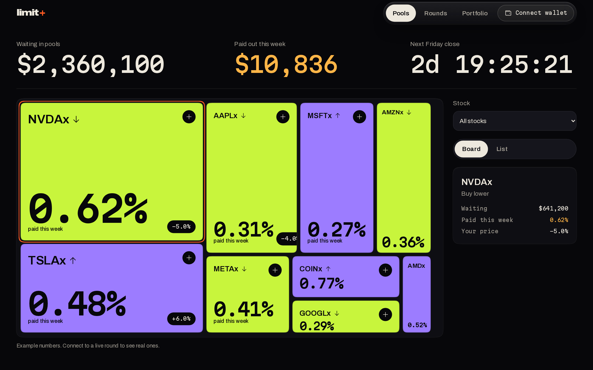
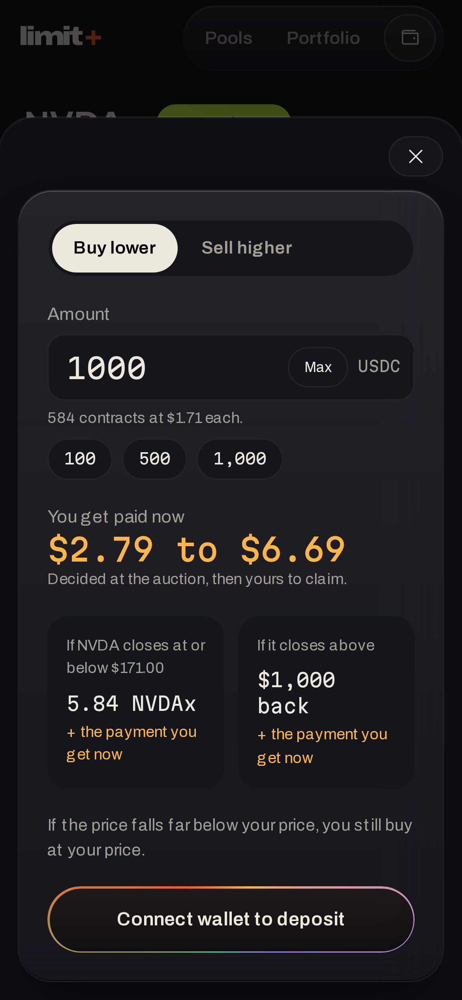
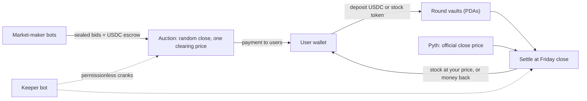

# Limit+

**Paid limit orders for tokenized stocks on Solana.**

Name your price for a stock token. Market makers pay you for the right to trade at it, decided in a sealed-bid auction that closes at a random moment. At Friday's official close you either buy at your price or get your money back, and you keep the payment either way.

Built for **Hack in Hills**. Prototype status: see [Project status](#project-status).

[](LICENSE)


<p align="center">
  
  
</p>

## The problem

A limit order is a free option you give the market: you say "I'd buy NVIDIA at $171" and then wait, sometimes all week, earning nothing. The few products that pay you to wait are custodial, and the venue sets the price.

## How Limit+ works

1. **You deposit and name a price.** Buy lower: deposit USDC for the price you want to buy at. Sell higher: deposit the stock token for the price you want to sell at.
2. **Market makers bid in a sealed auction.** Bids are committed as hashes with USDC in escrow, so nobody sees anyone else's price.
3. **The auction ends at a random moment.** A cutoff is drawn after bidding ends, so waiting until the last second cannot help. Bids placed after the cutoff do not count.
4. **One price clears for everyone.** Winners all pay the same clearing price. The proceeds, minus a protocol fee, are yours to claim.
5. **Friday's official close decides.** Pyth's closing price settles the round. If it crossed your price, the winning bidders exercise and you end up with the stock at your price. If not, you get your collateral back. Either way you keep the payment.



Each round is one stock, one side, one price and one expiry, and all users in a round share the same outcome pro rata.

## What is in this repository

| Path | What it is |
|---|---|
| `programs/limit_plus` | The Anchor program: rounds, vaults, sealed-bid auction, clearing, settlement, claims |
| `packages/sdk` | TypeScript client: PDAs, instruction builders, account decoders, bid commitment hashing |
| `packages/pricing` | Black-Scholes fair value, realized volatility, reserve price |
| `bots` | A market-maker bot and a permissionless keeper that cranks the round forward |
| `app` | Next.js frontend, built from the "Obsidian & Flame" design system |
| `scripts` | Local demo, round creation, Pyth settle script, seed script |
| `tests` | Integration tests that warp the clock through a full round (LiteSVM) |
| `video` | Remotion project for the pitch video |
| `docs` | Spec, test plan, design system, demo script, changelog |

## Quick start

Prerequisites: Rust, Solana CLI, Anchor CLI **0.32.1**, Node 20+, yarn (classic). `scripts/setup.sh` installs the toolchain.

```bash
yarn install

# Program build with the mock oracle (used by tests and the local demo)
anchor build -- --features mock-oracle

# Everything: Rust unit tests, integration tests, SDK and pricing tests
./scripts/test.sh

# A compressed end-to-end round on a local validator (about 2 minutes)
yarn ts-node -P tsconfig.json scripts/demo-run.ts

# The frontend (shows example data until NEXT_PUBLIC_RPC_URL points at a chain)
yarn workspace app dev
```

To see a live round in the UI, run `scripts/seed-localnet.ts --user <YOUR_WALLET>`, build the app with `NEXT_PUBLIC_RPC_URL=http://127.0.0.1:8899`, and set your wallet to localnet.

## Tests

| Layer | What it covers | Result |
|---|---|---|
| Rust unit tests | Fixed-point math, settlement price, fee split, cutoff derivation, commitment hash, Pyth decoder | 11 passing |
| Integration (LiteSVM) | Full lifecycle for both sides, in-the-money and out-of-the-money, partial fills, invalid and late bids, wrong salts, oracle checks, double claims, pause, unsupported mints, no-sale, plus the protocol invariants after each step | 21 scenarios passing |
| SDK and pricing | The TypeScript bid hash matches the Rust vector, Black-Scholes values | 7 passing |
| End to end | `scripts/demo-run.ts` runs a compressed round on a local validator with two bots and two concurrent keepers | Passing |

See [`docs/TEST_PLAN.md`](docs/TEST_PLAN.md) for the test list and [`docs/SPEC.md`](docs/SPEC.md) section 11 for the invariants.

## Design highlights

- **All money moves onchain.** Deposits, escrow, clearing, settlement and payouts are program instructions. Vaults are program-derived accounts owned by the round.
- **Sealed-bid, uniform-price auction.** Bids are `keccak256(round, bidder, price, qty, salt)` commitments. Clearing is deterministic: price descending, then commit time, then bidder.
- **Random close.** The cutoff is derived after bidding ends from the SlotHashes sysvar. The known limitation (a slot leader could bias it) is documented in the spec.
- **Pyth settlement.** The program decodes `PriceUpdateV2` directly, accepts only fully verified updates, and checks the feed id, publish time window and confidence.
- **Token-2022 aware.** Transfers use `transfer_checked` with each mint's own token program. Mints with transfer fees, hooks, interest bearing or other unsafe extensions are rejected at round creation.
- **Safe arithmetic.** No `unwrap`, no unchecked math, floor rounding on every payout, and a rule that all math lives in pure, unit-tested functions.

## Project status

This is a hackathon prototype.

Working and tested: the program, the SDK, the pricing engine, both bots, the local end-to-end demo, and the frontend (against a local chain or with example data).

Not done yet:
- **Devnet deployment.** The program has not been deployed to devnet, so there is no public demo chain.
- **Pyth settlement on a live network.** The decoder is verified against Pyth's source and unit-tested, but a real devnet settle has not been run.
- **Wallet flows on devnet.** Deposit and claim through Phantom have been exercised against a local validator only.
- **Out of scope for the prototype:** permissionless round creation, more than 20 bids per round, tradable option tokens, penalties for unrevealed bids, and an audit. See [`docs/SPEC.md`](docs/SPEC.md) section 13.

## Security and disclaimer

Limit+ has **not been audited** and must not be used with real funds. A token issuer with a permanent delegate can move tokens out of any account, including the vaults. Prices and payments shown in the app and the promotional video use **example numbers**. Nothing here is financial advice. Company names and logos are trademarks of their owners and are not affiliated with this project, see [`NOTICE.md`](NOTICE.md).

## Documentation

- [`docs/SPEC.md`](docs/SPEC.md): the protocol specification
- [`docs/TEST_PLAN.md`](docs/TEST_PLAN.md): every test and what it proves
- [`docs/DESIGN.md`](docs/DESIGN.md): the design system and mockups in `docs/mockups`
- [`docs/DEMO_SCRIPT.md`](docs/DEMO_SCRIPT.md): the live demo script
- [`docs/CHANGELOG.md`](docs/CHANGELOG.md): what changed in each phase
- [`docs/video`](docs/video): the pitch video script

## Team

Built by team MomoX for Hack in Hills.

## License

[MIT](LICENSE)
